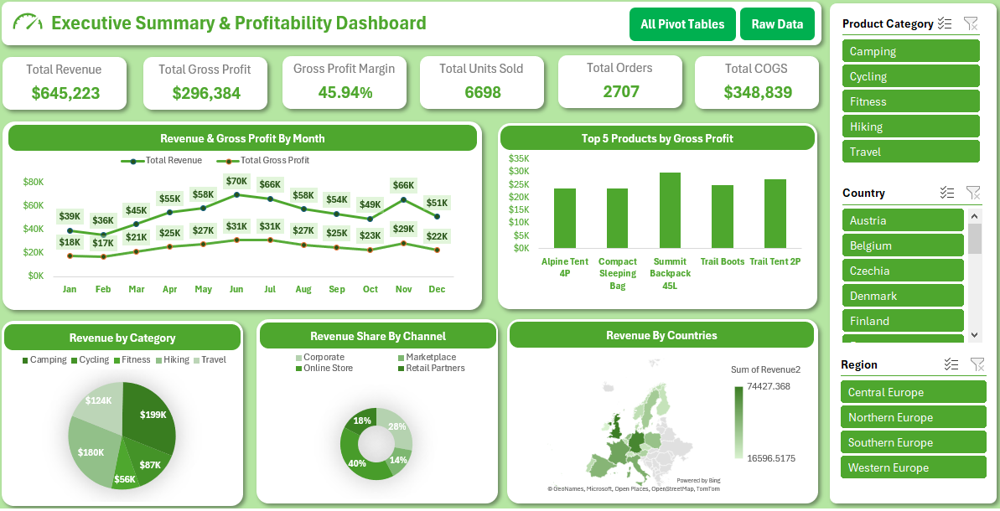

# 📊 Executive Summary & Profitability Dashboard – Excel

## Project Overview

The **Executive Summary & Profitability Dashboard** is an interactive Microsoft Excel dashboard designed to analyze sales performance, revenue trends, product profitability, and business performance across different countries and regions.

The dashboard uses Pivot Tables, Pivot Charts, Excel formulas, slicers, and data visualization techniques to transform raw sales data into meaningful business insights.

##Dashboard Preview

## Project Objectives

- Analyze overall sales and profitability performance.
- Monitor monthly Revenue and Gross Profit trends.
- Identify the most profitable products.
- Understand revenue distribution across product categories.
- Analyze sales contribution by different sales channels.
- Compare revenue performance across countries.
- Provide interactive filtering for better business analysis.

## Key Performance Indicators (KPIs)

The dashboard tracks the following KPIs:

| KPI | Value |
|---|---:|
| Total Revenue | $645,223 |
| Total Gross Profit | $296,384 |
| Gross Profit Margin | 45.94% |
| Total Units Sold | 6,698 |
| Total Orders | 2,707 |
| Total COGS | $348,839 |

## Dashboard Visualizations

The dashboard includes the following visualizations:

### 1. Revenue & Gross Profit by Month
- Tracks monthly Revenue and Gross Profit.
- Identifies monthly performance trends.
- Compares revenue and profitability throughout the year.

### 2. Top 5 Products by Gross Profit
- Highlights the five most profitable products.
- Helps identify products contributing the most to profitability.

### 3. Revenue by Category
- Shows revenue distribution across product categories.
- Categories include Camping, Cycling, Fitness, Hiking, and Travel.

### 4. Revenue Share by Channel
- Visualizes revenue contribution from different sales channels.
- Compares Corporate, Marketplace, Online Store, and Retail Partners.

### 5. Revenue by Countries
- Displays geographical revenue performance using an Excel Filled Map.
- Helps compare sales performance across different countries.

## 🎛️ Interactive Features

The dashboard includes interactive Excel slicers for:

- Product Category
- Country
- Region

Users can select different filters to explore sales performance and analyze business metrics dynamically.

Additional navigation buttons:
- **All Pivot Tables** – Navigate to the Pivot Tables sheet.
- **Raw Data** – Navigate to the original dataset.

##Tools & Technologies Used

- Microsoft Excel
- Excel Tables
- Pivot Tables
- Pivot Charts
- Excel Slicers
- Excel Formulas
- Filled Map Chart
- Data Cleaning and Transformation
- Conditional Formatting
- Dashboard Design and Data Visualization

